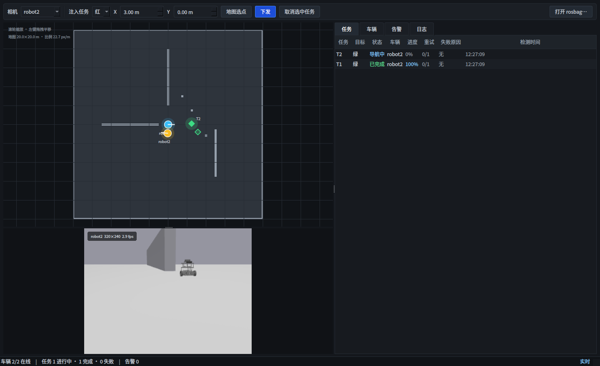
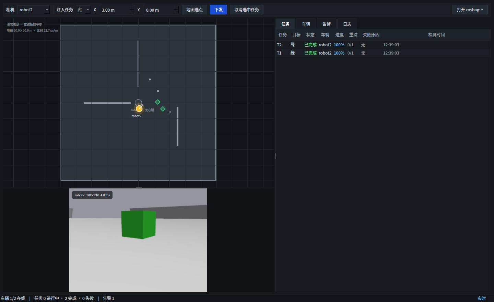
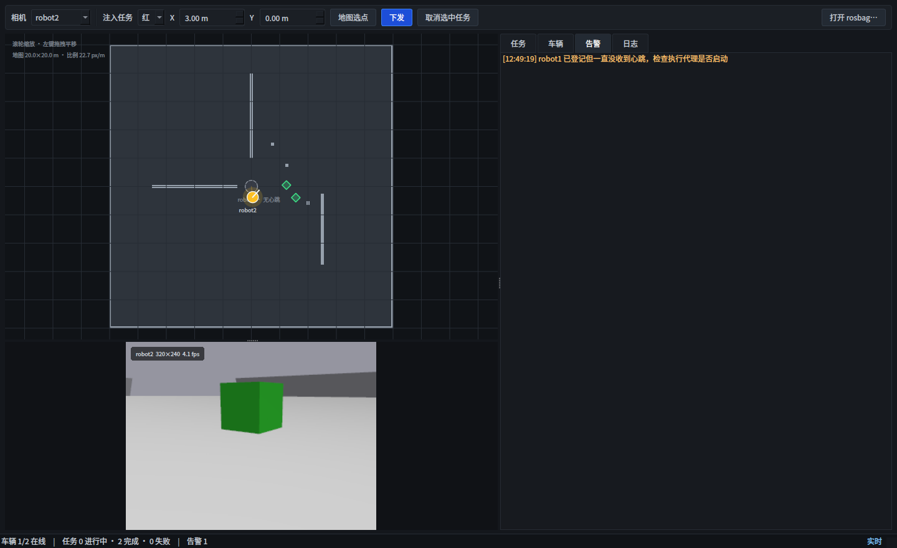
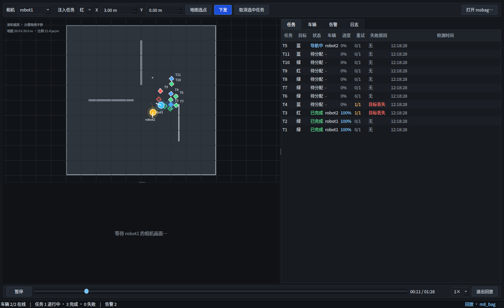

# ROS2 多机器人任务调度与监控系统

[](https://github.com/enenr2/ROS2-Multi-Robot-Task-Scheduling-and-Monitoring-System/actions/workflows/ci.yml)

默认两台、可扩展至五台 TurtleBot3 在 Gazebo 中自主作业：**视觉发现彩色目标 → 调度分配任务 → Nav2 导航到目标附近 → 视觉闭环精对位停车**，全过程通过话题与 action 可观测、可回放。

不同于只展示 3D 模型的仿真项目，本仓库的重点在工程细节：多机命名空间隔离、TF 树统一、接口版本化、纯逻辑单测、跨节点集成测试、故障注入与状态可观测。

当前状态：**M0–M9 已完成并通过仿真验收**。部署、运维与验收矩阵见 [交付文档](docs/交付文档.md)。

---

## 1. 系统架构

```
                     Gazebo (gz sim 10)  +  fleet_tasks.sdf 世界
                                  │
                        ros_gz_bridge (单车 8 类话题)
                                  │
      ┌───────────────────────────┼────────────────────────────┐
      ▼                           ▼                            ▼
 /robotN/odom            /robotN/camera/image           /robotN/scan
 /robotN/imu             /robotN/camera/camera_info     /robotN/cmd_vel
      │                           │                            │
      ▼                           ▼                            ▼
 里程计 / TF              fleet_perception          Nav2 (robot1 ... robotN)
  + AMCL 定位              HSV 分割 + 单目测距        navigate_to_pose
                          + 时序去抖                          │
                              │                               │
                              ▼                               ▼
                     /robotN/detections              action 客户端
                              │                               │
                              └───────────┬───────────────────┘
                                          ▼
                                   fleet_agent
                          ASSIGNED → NAVIGATING → DOCKING
                                          │
                       ┌──────────────────┴─────────────────┐
                       ▼                                    ▼
              /robotN/task_status                  /robotN/robot_status
              （任务状态事件流）                     （1 Hz 心跳，判活用）

  调度层 fleet_manager ── /robotN/execute_task (action) ──▶ fleet_agent
                                          │
                                          ▼
                          ┌───────────────────────────────┐
                          │ 监控端 fleet_gui（M8，Qt6）    │
                          │ /fleet/tasks + /robotN/心跳/状态│
                          │ /map + /robotN/camera/image    │
                          │ 注入/取消 ──▶ /fleet/*_task 服务│
                          │ rosbag2 ──▶ 时间轴回放          │
                          └───────────────────────────────┘
```

任务执行三段式：**导航**（Nav2 负责全局路径与避障，终点退到目标前 1.4 m 并让车头对准目标）→ **对位**（视觉闭环把航向收进 0.05 rad、距离收到 standoff 0.6 m）→ **收尾**（停车、发终态）。

定位：每台车跑一套 **AMCL**（`/robotN/scan` + 全局 `/map`），由 AMCL 发布 `map → robotN_odom`。gz 的里程计是轮速积分，实测跑十几米会漂 1~3 m；不用 AMCL 时各车会分别漂移，任务改派后新车按旧车报的世界坐标导航会停偏一两米。

---

## 2. 功能模块

| 包 | 职责 | 状态 | 测试 |
|---|---|---|---|
| `fleet_msgs` | 接口层：4 个 msg、2 个 srv、1 个 action | 完成 | — |
| `fleet_bringup` | 仿真底座：自建世界/地图/机器人模型、每车一套 Nav2 + AMCL、动态桥接配置、桥接配置、RViz、一键 launch | 完成 | — |
| `fleet_manager` | 调度：状态机、任务队列、分配策略、看门狗、失败冷却、终态任务保留 + ROS 适配节点 | 完成 | 54 gtest |
| `fleet_perception` | 感知：HSV 颜色识别、单目测距、时序去抖、TF 转世界系 | 完成 | 28 gtest |
| `fleet_agent` | 执行代理：封装 Nav2、视觉精对位、状态与心跳、安全停车 | 完成 | 21 gtest |
| `fleet_gui` | 监控台：任务/车辆/告警/日志、地图与相机、手动注入/取消、rosbag 时间轴回放 | 完成 | 15 gtest |
| `fleet_integration` | 真调度中心 + 假执行代理/假 Nav2 的跨节点集成测试（launch_testing） | 完成 | 8 用例 |

合计 **126 项测试，0 失败**（118 个 gtest + 8 个集成用例；CI 每次由 `scripts/test_summary.py` 生成汇总）。

分层原则：**能脱离 ROS 的数学与状态逻辑一律做成纯 C++ 库**，用注入时间驱动单测；ROS 节点只做接线与消息转换。

### 接口定义

| 类型 | 名称 | 用途 |
|---|---|---|
| msg | `Task` | 任务快照，供监控与回放 |
| msg | `TaskStatus` | 任务状态变更事件（含 `failure_reason`、`revision` 语义） |
| msg | `RobotStatus` | 机器人心跳（1 Hz，含递增序号） |
| msg | `Detection` | 视觉检测结果（map 系坐标、测距、不确定度、`lost` 事件标志） |
| srv | `SubmitTask` / `CancelTask` | 外部注入与取消任务 |
| action | `ExecuteTask` | 调度器每车直调，一次调用 = 一个任务全过程 |

行为约定：

- **取消是独立终态**：用户取消 → `CANCELED`，action `canceled()`、`task_status` 也发 `CANCELED`，
  不计入 `tasks_failed`；`RobotStatus` 新增 `tasks_canceled` 单独统计
- **standoff 是任务级参数**：`ExecuteTask.goal.standoff` 优先，缺省回退到 agent 启动参数，
  统一收在 0.25~2.0 m
- **终态任务保留策略**：默认保留 10 分钟 / 最多 500 条；保留期内参与去重（防止静止物块
  被反复建单），清出保留期后才允许同一位置重新建单

---

## 3. 环境依赖

- Ubuntu 26.04 + ROS 2 Lyrical
- Gazebo Sim 10（`ros_gz_sim` 桥接）
- Nav2 1.5.2（`nav2_controller/planner/behaviors/bt_navigator/map_server`）
- OpenCV 4.10（`cv_bridge`）
- Qt6 Widgets + rosbag2（M8 监控端与时间轴回放）

软件渲染环境下建议固定 `LIBGL_ALWAYS_SOFTWARE=1`（本项目已固化在 `~/.config/environment.d/`）。

---

## 4. 快速开始

```bash
# 1. 依赖（自动探测 ROS 发行版，幂等，逐项累计失败）
./scripts/install_deps.sh

# 2. 构建
source /opt/ros/lyrical/setup.bash
colcon build --symlink-install
source install/setup.bash

# 3. 默认双机：地图 + 桥 + Nav2 + 感知 + 执行代理 + RViz + Qt 监控台
ros2 launch fleet_bringup fleet_sim.launch.py gui:=false rviz:=true monitor:=true

# 或单独开监控台（仿真已在跑时）
ros2 run fleet_gui fleet_monitor

# 4. 容器化运行（可选）
docker compose build
docker compose up -d sim       # 无界面仿真
docker compose up monitor      # 需要图形会话
```

常用开关：`gui:=false|true`、`rviz:=false|true`、`nav2:=false|true`、`perception:=false|true`、`agent:=false|true`、`manager:=false|true`、`monitor:=false|true`。

### 3–5 台压测

`robot_count` 可配置 1–5 台；launch 会为每台车生成独立的 SDF、桥接项、TF 前缀、Nav2 参数与 agent。三台完整仿真建议关闭 GUI/RViz/Qt；五台建议同样 headless，并关闭感知或降低传感器频率后再测 Nav2 调度吞吐。

```bash
# 三台端到端仿真与冒烟
ros2 launch fleet_bringup fleet_sim.launch.py robot_count:=3 gui:=false rviz:=false monitor:=false
python3 scripts/smoke_sim.py --robot-count 3 --timeout 240

# 五台调度/导航压测（headless）
ros2 launch fleet_bringup fleet_sim.launch.py robot_count:=5 gui:=false rviz:=false monitor:=false
python3 scripts/smoke_sim.py --robot-count 5 --timeout 360 --boot-timeout 240
```

也可用 `robots:=alpha,beta,gamma` 指定 ID。五台完整相机与 AMCL 会明显增加 CPU、内存、DDS 和 Gazebo 渲染负载；压测前记录主机资源，并优先关闭 `gui`、`rviz`、`monitor` 与不需要的 `perception`。

调度器还会对已派单但未收到 agent 确认的任务执行 `assigned_timeout`（默认 10 秒）保护，
超时后按 `GOAL_ACK_TIMEOUT` 取消并重排，避免通信中断时任务永久停留在 `ASSIGNED`。

停仿真用 `./scripts/stop_sim.sh`：会 SIGTERM → 超时 SIGKILL，并清理 `/dev/shm/fastdds_*`。不要用 `pkill -f` 手工杀，卡在生命周期过渡的 Nav2 节点会忽略 SIGTERM 并残留成"同名僵尸节点"，下一次启动时生命周期管理器会卡住。

逐项验收：

```bash
colcon test                                   # 全部单测
colcon test-result --test-result-base build/fleet_manager

# 感知：测距标定 + 三色识别 + 误检率 + 丢失链路
python3 src/fleet_perception/scripts/verify_perception.py

# 执行：导航 → 对位 → 停车 + 并发拒绝 + 目标丢失
python3 src/fleet_agent/scripts/verify_agent.py

# 调度：自动发现 → 分配 → 执行 → 完成 + 服务注入/取消
python3 src/fleet_manager/scripts/verify_manager.py

# 故障注入：四类故障 + 调度层恢复（每个场景建议在干净仿真上单独跑）
python3 src/fleet_manager/scripts/verify_faults.py --scenario A

# 手动制造故障
python3 scripts/fault_injector.py robot-offline --robot robot1 --hold 20
python3 scripts/fault_injector.py nav-failure --robot robot1 --hold 25
python3 scripts/fault_injector.py target-lost --block block_blue
python3 scripts/fault_injector.py target-restore --block block_blue

# 监控台：任务/车辆/相机；冻结 agent 后 2.5s 判离线
ros2 run fleet_gui fleet_monitor
python3 scripts/fault_injector.py robot-offline --robot robot1 --hold 20

# 监控台回放：先录一段，再用时间轴回看
./scripts/record_demo_bag.sh /tmp/demo_bag 90
ros2 run fleet_gui fleet_monitor --replay /tmp/demo_bag

# 集成测试：真调度中心 + 假执行代理（不需要 Gazebo）
colcon test --packages-select fleet_integration --event-handlers console_direct+

# CI 同款：全部单测 + 集成测试
colcon test --packages-select fleet_manager fleet_perception fleet_agent fleet_gui fleet_integration \
  --return-code-on-test-failure
colcon test-result --all --verbose

# 端到端冒烟（需要仿真已启动；nightly 工作流也跑这一条）
python3 scripts/smoke_sim.py --timeout 200
```

故障场景与预期（详细映射见 `scripts/fault_injector.py` 头部注释）：

| 场景 | 注入手段 | 调度层应看到 | 结果 |
|---|---|---|---|
| A 机器人离线 | `SIGSTOP` 该车 `robot_agent` | 心跳超时 → `ROBOT_UNREACHABLE` → 改派 | 改派后完成 |
| B 任务超时 | 在线把 `nav_timeout` 缩到 2 s | 看门狗 `NAV_TIMEOUT` → 取消 → 改派 | 改派后完成 |
| C 导航栈卡死 | `SIGSTOP` 该车 `controller_server` | `NAV_ABORTED` → 改派（该车 Nav2 整栈下线，不会自愈） | 改派后完成 |
| D 目标丢失 | 对位阶段把物块移出视野 | agent 报 `TARGET_LOST` → 按重试配额（默认 3 次）改派 | 重试用尽 `FAILED` |

> C 会让故障车的 Nav2 被 lifecycle bond 判死并 deactivate，这是真实的"导航栈需要人工介入"，所以放在最后跑。四个场景建议逐个重启仿真，避免上一轮的里程计/任务残局影响判断。

> 反复 launch/kill 后若某台车的静态 TF 莫名消失（`/tf_static` 里看不到该车连杆），先清理 `/dev/shm/fastdds_*` 再启动 —— 这是 Fast DDS 共享内存段残留，不是代码问题。

---

## 5. 实测验收数据

**感知层**（320×240 / fx=277.19，物块 0.2 m 立方体）

| 项目 | 结果 |
|---|---|
| 单目测距 1 / 2 / 3 m | 误差 +0.019 / +0.023 / −0.031 m（门槛 0.2 m） |
| 三色识别 | 红/绿/蓝各 25 帧全部正确，零串色 |
| 误检率 | 视野内无目标连续 60 s，上报 0 条 |
| 目标丢失 | 移走已捕获目标后，丢失事件恰好上报 1 次 |
| 上报率 | 约 4.5 Hz，与软件渲染下的相机帧率一致 |
| 偏轴退化 | 12° 偏小 0.05 m；24° 偏小 0.17~0.20 m（轮廓外接框把侧棱投影算进宽度） |

**执行层**

| 项目 | 结果 |
|---|---|
| 3 m 外目标全流程 | 导航 + 对位 + 停车，耗时 17.4 s，`SUCCEEDED` |
| 停车距离 | 0.693 m（目标 0.6 m，门槛 ±0.15 m） |
| 航向误差 | 0.00°（容差 2.9°） |
| 状态序列 | `ASSIGNED → NAVIGATING → DOCKING`，`task_status` 终态 `DONE`、progress 1.0 |
| 心跳 | 执行期 `BUSY`、结束回 `IDLE`、序号递增 |
| 并发下发 | 第二个任务被立即拒绝 |
| 对位中目标丢失 | 进入非成功终态，`failure_reason = TARGET_LOST` |

**调度层**（M6）

| 项目 | 结果 |
|---|---|
| 自动发现 | 目标进入视野后自动建单，无需人工注入 |
| 分配 | 派给最近的允许派活车辆（robot1；robot2 无 Nav2 只监控） |
| 状态链 | `PENDING → ASSIGNED → NAVIGATING → DOCKING → DONE` |
| 停车精度 | 车到物块中心 0.82 m（期望约 0.73 m） |
| 监控输出 | `/fleet/tasks` 快照 + `/fleet/task_markers` 持续发布 |
| 服务 | `SubmitTask` 建单、重复提交被去重拒绝、`CancelTask` 中止执行中的任务并回到 IDLE |

**导航层**（M2）

| 项目 | 结果 |
|---|---|
| 单机 Nav2 目标点 | 落点误差 0.198 m / 0.2 m，两次均 `SUCCEEDED` |
| 多机隔离 | 双机话题、TF、命名空间无冲突，robot2 零漂移 |
| AMCL 定位（M7） | `map → base_footprint` 与仿真真值差 0.10 m（此前纯里程计漂移 1~3 m） |

**故障恢复**（M7，每个场景独立干净仿真）

| 场景 | 判定项 | 结果 |
|---|---|---|
| A 机器人离线 | 建单 / 心跳超时重排 / 原因 `ROBOT_UNREACHABLE` / 改派另一台 / 最终 `DONE` | 全通过 |
| B 任务超时 | `nav_timeout` 在线生效 / 看门狗重排 / 原因 `NAV_TIMEOUT` / 改派 / 最终 `DONE` | 全通过 |
| C 导航栈卡死 | 导航失败重排 / 原因 `NAV_ABORTED` / 改派 / 最终 `DONE` | 全通过 |
| D 目标丢失 | 进入对位 / 最终 `FAILED` / 恰好重试 1 次 / 原因 `TARGET_LOST` | 全通过 |

**监控端**（M8）

| 项目 | 结果 |
|---|---|
| 双车在线状态 | 心跳 1 Hz，2.5 s 无心跳判离线；冻结 agent 后界面显示 `1/2 在线` 并给告警 |
| 从未上线 | 只发现话题、没有心跳的车登记为"离线占位"，2 倍超时后告警一次 |
| 相机流 | 320×240 @ 4~5 fps，与桥接帧率一致；切换车辆不重启节点 |
| 任务表 | 12 个任务按 2 Hz 快照刷新，`revision` 去重、状态跳变去抖 |
| 手动注入 | 颜色 + 坐标经 `/fleet/submit_task` 建单，成功/拒绝均有回显 |
| rosbag 回放 | 88 s / 7 话题的 mcap：拖动时间轴、1/2/4/8 倍速播放正常 |
| 单测 | `monitor_core` 13 gtest + `replay_core` 2 gtest（自写 bag 再读回） |

---

## 6. 监控端（M8）

`fleet_gui` 是 Qt6 Widgets 桌面端：ROS 节点在独立线程跑单线程执行器，回调只做
"消息 → 纯结构体 / QImage"的转换后发 Qt 信号，界面线程不加锁；任务合并、心跳判活、
告警生成都在 `monitor_core` 里，用注入时间戳的单测覆盖。

| 区域 | 内容 |
|---|---|
| 地图 | `/map` 栅格、机器人位姿与轨迹、任务目标；滚轮缩放、拖拽平移、双击复位 |
| 任务表 | 任务号/颜色/状态/执行车/进度/重试/失败原因/首次发现时间；选中一行可取消 |
| 车辆表 | 在线状态、位姿、当前任务、完成/失败数、心跳年龄与序号 |
| 告警 / 日志 | 状态跳变、失败原因、重排、心跳中断；按严重度着色，告警单独一页 |
| 相机 | `/robotN/camera/image` 实时流，可切换车辆，叠加分辨率与帧率 |
| 操作 | 手动注入任务（颜色 + 坐标，支持地图点选）、取消选中任务 |
| 回放 | 打开 rosbag2 目录，时间轴拖动 + 1/2/4/8 倍速；任务、心跳、状态事件可回放 |



冻结 robot1 的 `robot_agent` 后：地图上该车变灰虚线、状态栏 `1/2 在线`、告警 +1。
上方相机是 robot2 的画面（正在对位绿色物块）。



告警页把同一批事件按严重度单独列出（对应上图状态栏的 `告警 1`）：



打开一段 rosbag：时间轴可拖动、可倍速；bag 里没有图像，相机页显示等待提示。



命令行参数：

| 参数 | 用途 |
|---|---|
| `--camera <robot>` | 初始显示的相机（默认 robot1） |
| `--tab <name>` | 初始页：任务 / 车辆 / 告警 / 日志（默认任务） |
| `--replay <dir>` | 启动后直接载入 rosbag2 目录 |
| `--screenshot <png> --quit-after <s>` | 渲染完成后截图并退出，用于验收/CI |

回放数据用 `./scripts/record_demo_bag.sh [目录] [秒数]` 采集（任务快照、心跳、
状态事件、检测结果，默认 90 s）；回放只读这三类话题，bag 里没有图像。

---

## 7. 目录结构

```
fleet_ws/
├── src/
│   ├── fleet_msgs/          # msg / srv / action 接口层
│   ├── fleet_bringup/       # 世界、地图、模型、桥接、Nav2 参数、launch、RViz
│   │   ├── worlds/fleet_tasks.sdf
│   │   ├── maps/            # 与自建世界同源生成的地图
│   │   ├── models/robot1|2/ # 带相机与激光的 TurtleBot3
│   │   ├── config/          # bridge.yaml / nav2_robot1.yaml / fleet.rviz
│   │   └── launch/fleet_sim.launch.py
│   ├── fleet_manager/       # 调度核心（纯逻辑，54 gtest）+ ROS 适配节点（fleet_manager_node）
│   │   └── scripts/verify_faults.py   # 四类故障注入验收（A/B/C/D）
│   ├── fleet_perception/    # 颜色 + 测距 + 去抖（28 gtest，含验收脚本）
│   ├── fleet_agent/         # 执行代理（21 gtest，含验收脚本）
│   ├── fleet_gui/           # 监控台（Qt6，monitor_core + replay_core 共 15 gtest）
│   └── fleet_integration/   # 假 agent / 假 Nav2 + launch_testing 集成测试（8 用例）
├── docker/                  # Dockerfile + entrypoint
├── .github/workflows/       # CI（构建/测试/镜像）
├── docs/                    # 设计文档、交付文档、监控台截图
└── scripts/
    ├── install_deps.sh      # 依赖安装（幂等、逐项累计失败）
    ├── fault_injector.py    # 故障注入器（SIGSTOP 进程 / 挪动物块）
    ├── record_demo_bag.sh   # 录制标准回放包
    ├── stop_sim.sh          # SIGTERM→SIGKILL 停仿真并清 Fast DDS 共享内存
    └── commit.sh            # 固化提交身份、过滤协作标记
```

---

## 8. 工程要点与踩坑记录

这些问题都在仿真里实际踩过，修复方式已固化进代码：

**多机器人**
- 不同机器人的 URDF 连杆/关节名必须在生成期加全局前缀 —— 只靠 `frame_prefix` 会导致 RViz 同名帧覆盖、模型轮流显示
- 官方 Nav2 launch 会把 `/tf` 重映射成相对名，在命名空间下变成 `/robotN/tf`；多机必须强制回全局 `/tf`、`/tf_static`
- Nav2 参数必须以完整限定名或 `/**` 匹配，普通节点名匹配不上
- 全局代价地图默认订阅 `/robotN/map`，共享地图要重映射成完全限定名 `/map`

**Nav2 1.5**
- 默认发布 `TwistStamped`，与桥接的 `Twist` 不兼容，需关闭 `enable_stamped_cmd_vel`
- `lifecycle_manager` 的 `service_timeout` 默认 5 s，在本机高负载下不够，会中止 bringup，已放宽到 20 s
- 低性能仿真优先 RPP 控制器而非 MPPI
- 两套 Nav2 的 10 个进程同时上线时，DDS 发现阶段会挤掉 lifecycle 的 `change_state` 响应（日志 `failed to send response ... change_state (timeout)`，bringup 永久卡在 `Configuring xxx`）；两套栈错开 10 s 启动后稳定

**定位与故障注入（M7）**
- gz 的 `DiffDrive` 里程计是轮速积分：`set_pose` 搬动机器人不会改 odom，搬完 TF 与真实位姿脱节；也不能用它模拟"原地打滑"，Nav2 会认为自己在正常前进
- 两台车的轮式里程计各自漂移（实测 1~3 m），跨车传递世界坐标必须统一到同一张地图 —— 改用每车一套 AMCL 后落点误差降到 0.1 m
- 冻结 `controller_server` 会连带断掉 lifecycle bond，整台车的 Nav2 被 deactivate；这是不可自愈故障，适合验收"改派"，不适合验收"故障车自愈"
- 收起来的物块要放场外（如 `(20,20)`）：放在场内角落时，8 m 外的小像素框会被单目测距当成 5 m 内的目标，清场与摆位期间不断冒出幽灵任务
- 改派后新车沿用旧车报的目标坐标，落点可能偏差米级；agent 到达对位点后若一直看不到目标，先倒车退出"贴脸"盲区、再原地转一圈搜索，仍找不到才报 `TARGET_LOST`
- 任务改派要校验归属：旧车恢复后补发的 `NAVIGATING/DONE` 和迟到的 action result 都可能落在已改派的任务上，必须比对 `assigned_robot` 与 `robot_task_`
- 机器人从离线恢复时要撤销它残留的导航目标，否则它会去抢已经改派给别的车的物块

**监控端（M8）**
- 跨线程发自定义结构体信号必须注册元类型；`Q_DECLARE_METATYPE` 要放在一个被所有带 `Q_OBJECT` 的头文件共同包含的独立头里 —— 否则多个 moc 文件拼进 `mocs_compilation.cpp` 时会"先实例化、后特化"，编译直接报 `specialization after instantiation`
- `QRectF::bottom()` 返回 `y + height`（不是最小 y），按直觉用它画地图会得到零高度矩形，表现为"地图收得到但画不出来"
- 仿真里 `Task.detected_at` 是 sim time，与界面日志的墙钟不同源；任务表时间列改用"本端首次看到该任务"的时间，回放时改用 bag 录制时间
- 只订阅 `/robotN/*` 时，agent 从未发过心跳的车在界面上根本不存在；发现话题后先登记成"离线占位"，2 倍心跳超时仍无心跳再告警一次
- 回放只读 `/fleet/tasks`、`/robotN/robot_status`、`/robotN/task_status`：bag 里没有图像，相机页会显示等待提示
- `QWidget::grab()` 在 offscreen 平台也能稳定出图，适合无人值守截图；不要指望窗口管理器按 `resize()` 给尺寸
- 后台用 `ros2` 进程做故障注入时，若该进程依附于会被复用的终端，验证中途可能被连带杀掉，故障窗口就消失了；长时间保持的注入要 `setsid` 脱离终端

**集成测试与交付（M9）**
- `launch_testing` 的 `Node(executable=...)` 要求安装到 `lib/<pkg>/` 的名字不带 `.py`，用 `install(PROGRAMS ... RENAME fake_agent)`；否则报 `executable 'fake_agent' not found on the libexec directory`
- 集成测试的 `wait_until` 持锁判断，若谓词内部再调 `snapshot()` 一类带锁的取值函数，普通 `Lock` 会自锁死（现象是 180 s 超时且没有任何断言输出）；改用 `RLock`
- sqlite3 后端读出来 `send_timestamp` 恒为 0（只存一列 timestamp），时间轴要用 `recv_timestamp` 兜底；mcap 两者都有。回放实现已同时兼容
- 本机访问不了 Docker Hub 时 `docker manifest inspect` / `docker pull` 都会失败，镜像是否可构建只能交给 CI 的 `docker` job；本地用 `docker compose config` 校验配置
- CI 不跑 Gazebo：单测覆盖纯逻辑，跨节点链路用假 agent 覆盖；导航/对位/故障注入放在开发机按验收脚本执行
- 回放自测需要真 bag，所以用 `rosbag2_cpp::SequentialWriter` 在临时目录造一个 sqlite3 包，再交给 `LoadBag` 读回

**调度与执行（复审修复）**
- "只对活跃任务去重"会形成**无限任务环**：物块静止、感知 4~5 Hz 持续上报，任务一 DONE 就被立刻重新建单（实测一分钟内建了 35 个任务）。保留期内的终态任务必须继续参与去重，靠保留策略清理后再重新建单
- 取消不是失败：`Finish()` 必须分成功/取消/失败三态；goal 已处于 canceling 时再调 `succeed()`/`abort()` 会抛异常，终态要发 `CANCELED` 而不是 `FAILED`
- `goal.standoff` 之前只写进了 action 但 agent 只读启动参数，属于"看起来可配、实际无效"；现在由 agent 在任务开始时覆盖并做范围校验
- cmd_vel 是安全通道：可靠 QoS + KeepLast(1)，停车统一走 `CmdVelLink` 连发多帧零速；退出、取消、失败收尾都调用同一个 `Stop()`

**感知**
- tf2 禁止在回调里带超时查 TF（数据靠本节点执行器喂入，带超时等于自己等自己）；图像戳常比最新 TF 早/晚几毫秒，失败时退化为"最新位姿"
- 颜色阈值必须限制饱和度下限，否则灰白墙面与地面会被误判

**并发与进程管理**
- action 服务端回调组必须用 `Reentrant` + 总线互斥标志，否则新任务请求会排在长时间 `execute` 后面、等前一任务结束才被处理
- 终态只由 action result 承载：feedback 走话题、result 走服务响应，无顺序保证
- Nav2 节点在生命周期过渡卡住时会忽略 SIGTERM，残留进程与下次启动形成同名节点，`lifecycle_manager` 会一直卡住；用 `scripts/stop_sim.sh` 做 SIGTERM→SIGKILL 清理
- `bt_navigator` 默认只等 20 ms 连 `planner_server` 的 action server，节点刚激活时可能报 `compute_path_to_pose not available` 并拖垮整个 bringup，已把 `default_server_timeout` 提到 5000 ms

---

## 9. 已知限制

- 相机在软件渲染下实际约 4 Hz，视觉对位限速 0.15 m/s；激光约 2.3 Hz
- 感知每色只上报一个目标（当前场景三色各一块足够），偏轴测距会系统性偏小
- 两台车都接入 Nav2 + AMCL，`dispatch_robot_ids` 可控制派活范围
- AMCL 依赖手写地图与仿真激光，真实场地需要重新建图并标定；粒子滤波在长走廊场景仍需调参
- 调度中心的超时是"兜底"：正常失败由 agent 先报，看门狗只处理 agent 失联/卡死的情况
- 监控端回放不含图像（bag 里没录相机），相机页在回放期间停更
- 回放把整包读进内存，适合分钟级 bag；小时级数据需要改成按时间 seek
- 任务表/车辆表每 500 ms 全量重建，任务数上千时需要换成增量模型
- Qt 端在软件渲染下验证；高 DPI 与超宽屏未做专门适配
- 集成测试覆盖的是 manager ↔ agent 契约，不覆盖 Nav2 / 感知链路，后者靠 nightly 冒烟与开发机仿真验收
- 终态任务保留期内（默认 10 分钟）同一位置不会重复建单；需要重新巡检要么移动物块，要么等保留期过期
- 历史任务归档依赖 rosbag 录制（`record_demo_bag.sh`），调度器只做内存保留与清理
- cmd_vel 看门狗需要底盘驱动实现；agent 侧只保证停车命令、退出/取消/失败时发零速
- Docker 镜像未在开发机实际构建（Docker Hub 不可达），仅在 CI 中构建验证
- CI 不跑 Gazebo：3D 仿真慢且易受环境影响；nightly 工作流单独做 headless 冒烟

---

## 10. 路线图

| 里程碑 | 内容 | 状态 |
|---|---|---|
| M0 | 环境骨架与接口层 | 完成 |
| M1 | 仿真底座（世界/地图/模型/桥接/一键启动） | 完成 |
| M2 | robot1 接入 Nav2 单机导航 | 完成 |
| M3 | 调度核心逻辑与 49 个单测 | 完成 |
| M4 | 感知层（颜色识别 + 单目测距 + 去抖） | 完成 |
| M5 | 执行代理（Nav2 封装 + 视觉精对位 + 心跳） | 完成 |
| M6 | `fleet_manager` ROS 适配：队列/分配/超时重试接 action，服务与 RViz Marker | 完成 |
| M7 | 故障注入：目标丢失、导航失败、机器人离线、任务超时、重新分配 + AMCL 共享定位 | 完成 |
| M8 | Qt6 监控端：任务列表、机器人在线状态、告警、日志、相机流、rosbag 时间轴检索 | 完成 |
| M9 | 集成测试、rosbag 回放固化、Docker、CI、交付文档 | 完成 |

后续可选方向：真机适配（重新建图与相机标定）、多楼层/多区域地图切换、
Fast DDS Discovery Server 跨主机部署、任务数上千时的增量式监控模型。

---

## 11. 相关文档

- [交付文档](docs/交付文档.md)：部署（本地/Docker/CI）、运行手册、故障处理、验收矩阵
- [项目设计文档](docs/项目设计文档_v2.md)：架构与模块设计

---

